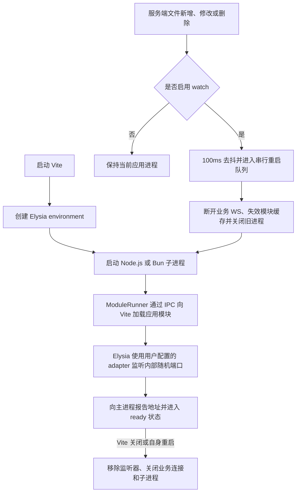
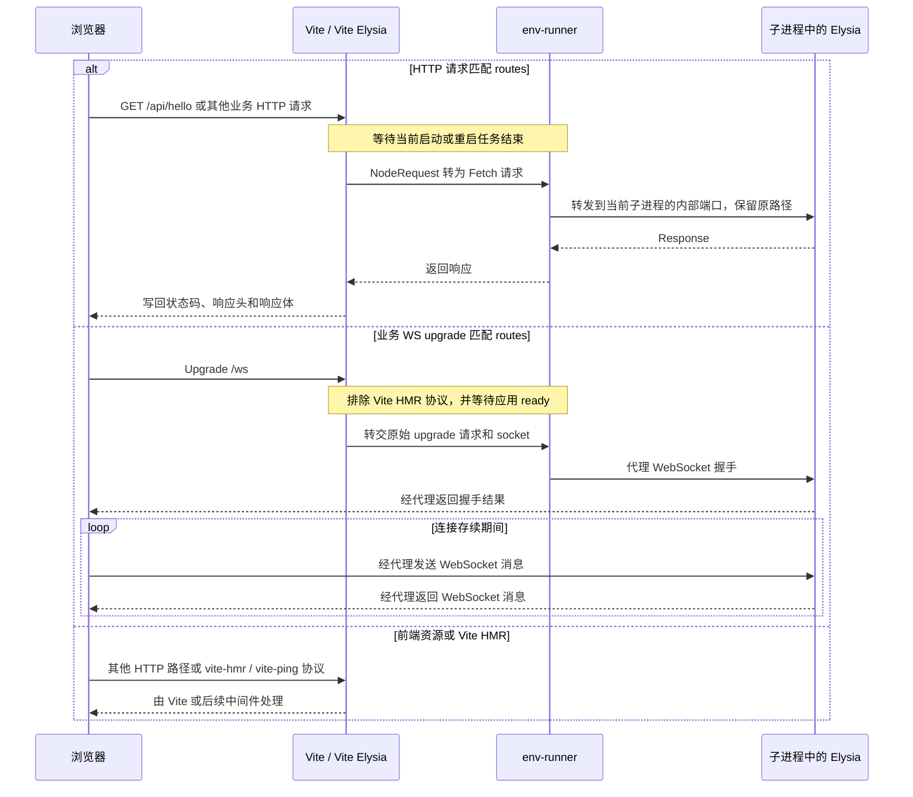

# Architecture / 运行架构

[English README](../README.md) · [简体中文](../README.zh-CN.md)

## Process lifecycle / 运行流程

Vite transforms application modules in the host process. A separate Node.js or Bun process loads them over IPC and starts Elysia with the user-selected adapter. File changes enter a serial restart queue when watching is enabled.

Vite 主进程转换应用模块，独立的 Node.js 或 Bun 子进程通过 IPC 加载模块，并使用用户配置的 adapter 启动 Elysia。启用监听时，文件变更进入串行重启队列。

## Request flow / 请求流转

Matching HTTP requests and business WebSocket upgrades are forwarded to the active application process. Frontend assets and Vite HMR remain with Vite. The public address stays stable while internal ports can change across restarts.

匹配的 HTTP 请求和业务 WebSocket upgrade 转发给当前应用进程。前端资源与 Vite HMR 仍由 Vite 处理；公开地址保持不变，内部端口可以随重启变化。

New application requests wait for the current startup or restart task. An unavailable application returns HTTP 503; forwarding errors return 502. Business WebSockets are closed when the application is unavailable or restarted, and clients must reconnect.

新业务请求等待当前启动或重启任务。应用不可用时 HTTP 返回 503，转发异常返回 502。应用不可用或重启时业务 WS 会关闭，客户端需要自行重连。
